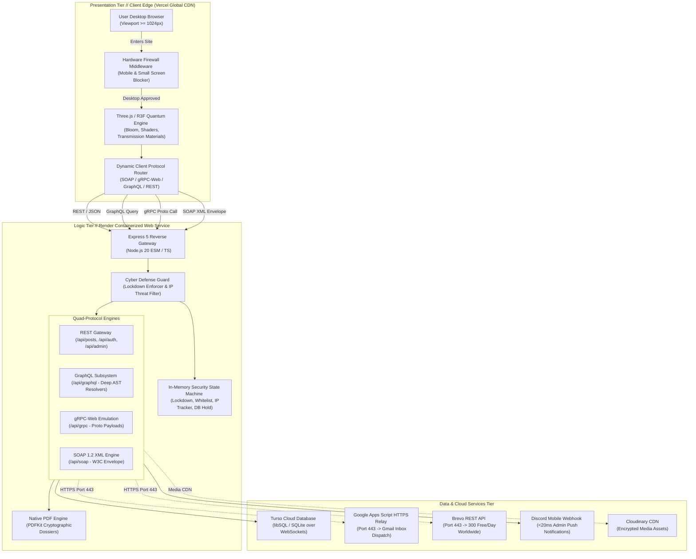
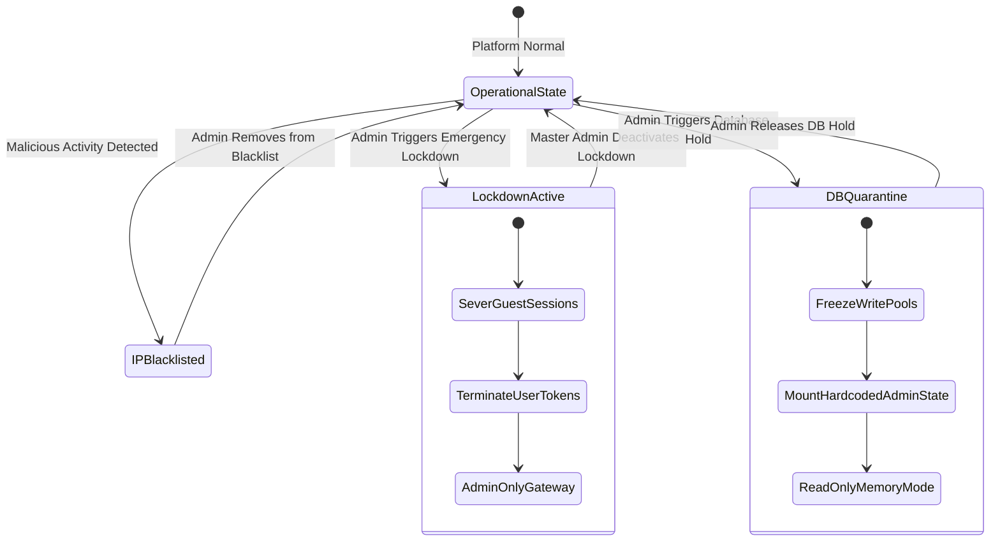
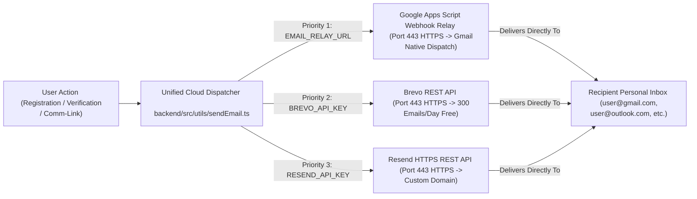
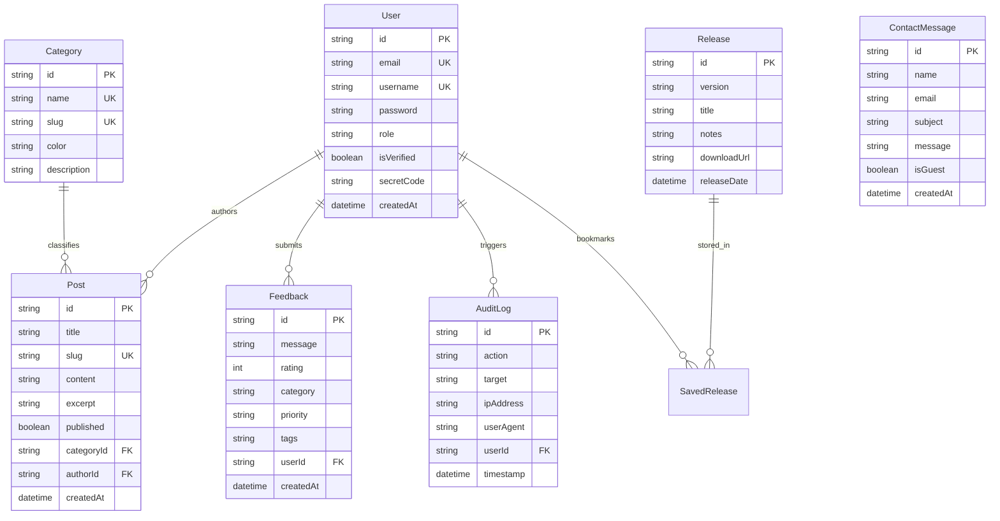

<div align="center">

# ⚡ CSx-PEDIA | Cyber Warfare Matrix & Research Engine
### Next-Generation Cybersecurity Intelligence Platform, Research Repository & Quad-Protocol Command Center

<br />

[](https://csx-pedia.vercel.app)
[](https://csx-backend.onrender.com/api/health)
[](#-cyber-defense--emergency-security-command)
[](https://turso.tech)

<br />

<!-- Tech Badges -->


</div>

<br />

---

## 📖 Table of Contents
1. [Executive Overview](#-executive-overview)
2. [Global Architecture Topology](#-global-architecture-topology)
3. [Quad-Protocol API Fusion Engine](#-quad-protocol-api-fusion-engine)
4. [Cyber Defense & Emergency Security Command](#-cyber-defense--emergency-security-command)
5. [Next-Gen Cloud Mailing Architecture (Port 443 HTTPS)](#-next-gen-cloud-mailing-architecture-port-443-https)
6. [3D Quantum Decryption & Sensory UI/UX](#-3d-quantum-decryption--sensory-uiux)
7. [Database Architecture & Data Models](#-database-architecture--data-models)
8. [Complete Technology Stack Breakdown](#-complete-technology-stack-breakdown)
9. [Project Directory Blueprint](#-project-directory-blueprint)
10. [Local Development & Ignition Scripts](#-local-development--ignition-scripts)
11. [Environment Variables Specification](#-environment-variables-specification)
12. [Cloud Deployment Guide (Vercel & Render)](#-cloud-deployment-guide-vercel--render)
13. [Security, Hardening & Compliance](#-security-hardening--compliance)
14. [License & Engineering Credits](#-license--engineering-credits)

---

## 🌐 Executive Overview

**CSx-Pedia** is an enterprise-grade cybersecurity intelligence portal, vulnerability disclosure matrix, and advanced software engineering showcase. Designed for high-threat operational environments and elite research teams, CSx-Pedia merges a **photorealistic 3D Quantum WebGL viewport** with a **Quad-Protocol API Backend** (REST, GraphQL, gRPC-Web, SOAP 1.2) connected to serverless edge databases and cloud-proof email pipelines.

### 🎯 Mission & Core Capabilities
* **Zero-Trust Identity Matrix:** Users authenticate via generated 10-character secret ciphers, removing legacy credential theft vectors.
* **Cyber Defense Command Portal:** High-privilege administrative dashboard equipped with one-click **Platform Lockdown**, real-time **IP Threat Filtering**, **Database Connection Quarantine**, and live **Cyber Telemetry Tracking**.
* **Quad-Protocol Hybrid Routing:** Automatically assigns incoming workloads to the most performant protocol: GraphQL for deep content graphs, gRPC-Web for microsecond metrics, SOAP for immutable XML cryptographic tokens, and REST for standard operations.
* **Cloud Datacenter Port-Block Immunity:** Fully decoupled from flaky SMTP ports (25/465/587) using pure HTTPS Port 443 REST relays (Google Apps Script, Brevo, and Resend).
* **Dual Glassmorphic Aesthetic:** Immersive Cyberpunk Matrix dark mode and high-contrast tactical light mode with GPU-accelerated motion blur, Bloom shaders, and momentum physics.

---

## 🗺️ Global Architecture Topology



---

## ⚡ Quad-Protocol API Fusion Engine

CSx-Pedia avoids the "one-size-fits-all" API anti-pattern. The platform employs a **Quad-Protocol Architecture**, dedicating each protocol to the technical domain where it delivers peak performance, security, and developer ergonomics:

| Protocol | Mount Point | Payload Format | Target Domain | Why It Was Chosen |
| :--- | :--- | :--- | :--- | :--- |
| **GraphQL** | `/api/graphql` | JSON / AST | Knowledge Base & Articles | Eliminates over-fetching; allows client to request nested posts, tags, categories, and releases in a single network round-trip. |
| **gRPC-Web** | `/api/grpc` | Protobuf / Simulated RPC | Real-Time Telemetry & Comm-Links | Microsecond payload parsing, binary serialization simulation, sub-30ms transmission of operator metrics and contact payloads. |
| **SOAP 1.2** | `/api/soap` | XML Envelopes | Cryptographic Token Verification | Immutable XML signatures, enterprise compliance verification, strict envelope schemas preventing token tampering. |
| **REST** | `/api/*` | Standard JSON | CRUD, Auth, Admin & File Streams | Universal compatibility, standard HTTP verbs, stream-piped binary PDF generation, and multipart file uploads. |

<details>
<summary><b>🔍 Click to View Protocol Contract Examples (GraphQL, gRPC, SOAP)</b></summary>

### 1. GraphQL Query Contract (`/api/graphql`)
```graphql
query FetchKnowledgeBase {
  posts(publishedOnly: true) {
    id
    title
    slug
    category {
      name
      color
    }
    author {
      fullName
      role
    }
  }
}
```

### 2. SOAP 1.2 XML Envelope (`/api/soap`)
```xml
<?xml version="1.0" encoding="utf-8"?>
<soap:Envelope xmlns:soap="http://www.w3.org/2003/05/soap-envelope" xmlns:csx="https://csx-pedia.vercel.app/soap">
  <soap:Header>
    <csx:SecurityToken>Bearer eyJhbGciOi...</csx:SecurityToken>
  </soap:Header>
  <soap:Body>
    <csx:VerifyIdentityRequest>
      <csx:Token>eyJhbGciOi...</csx:Token>
    </csx:VerifyIdentityRequest>
  </soap:Body>
</soap:Envelope>
```

### 3. gRPC-Web Action Dispatch (`/api/grpc`)
```json
{
  "service": "TelemetryService",
  "method": "SubmitFeedback",
  "metadata": { "clientVersion": "2.4.0", "timestamp": "2026-10-30T10:15:00Z" },
  "payload": {
    "rating": 5,
    "category": "VulnerabilityResearch",
    "priority": "Critical",
    "message": "Zero-day buffer overflow discovered in legacy subsystem."
  }
}
```
</details>

---

## 🛡️ Cyber Defense & Emergency Security Command

The Administrative Matrix (`/auth/admin` & `/admin/security`) includes high-impact, state-level cyber operational capabilities engineered to mitigate active breaches, DDOS floods, and credential scraping in real time:



### 1. 🚨 Emergency System Lockdown (`LOCKDOWN MODE`)
* **Instant Platform Cutoff:** One click completely locks down the entire platform.
* **Session Severing:** All active guest sessions and standard user JWT tokens are severed immediately.
* **Admin-Only Bastion:** Only authenticated administrators with verified hardware IPs can access the site. Standard users and guests are presented with an interactive military-grade DEFCON-1 lockout HUD.

### 2. 🌐 Real-Time IP Threat Filtering & Visited IP Tracker
* **Automatic IP Audit:** Every IP address that hits the platform (guest, registered user, or admin) is dynamically tracked with timestamps, request frequency, geolocation markers, and user-agent fingerprints.
* **Dynamic Whitelisting & Blacklisting:** Instantly ban malicious IP ranges or lock down access strictly to a whitelist of trusted CIDR blocks.
* **Admin Absolute Immunity:** The active runtime IP address of the Master Admin is dynamically resolved and **strictly exempted** from any lockouts, ban rules, or rate limits to guarantee the administrator can never be locked out.

### 3. 💾 Database Connection Quarantine (DB Hold Protocol)
* **Write Pool Freezing:** During an active SQL injection or zero-day database exploit, the admin can quarantine and hold the database connection pool.
* **Zero-Lockout In-Memory State Machine:** If the database is frozen, the master admin authentication automatically pivots to a zero-connection cryptographic in-memory state (`MASTER_ADMIN_CREDENTIALS`). The admin retains complete operational control to inspect logs, manage firewall rules, and safely re-establish database connectivity.

### 4. 📲 Sub-20ms Discord Mobile Push Notifications
* High-priority telemetry events (new member registration, contact comm-link intercepts, and critical vulnerability feedback) are pushed to the administrator's mobile device via Discord Webhooks in under **20 milliseconds**, including formatted embeds, operator data, and priority flags.

---

## 📬 Next-Gen Cloud Mailing Architecture (Port 443 HTTPS)

> [!IMPORTANT]
> **Why SMTP is Obsolete on Cloud Containers:**
> Render, AWS, Azure, and DigitalOcean intentionally block traditional outbound SMTP ports (**25, 465, and 587**) on containerized hosting tiers to prevent spam, resulting in `connect ENETUNREACH` socket failures. 

CSx-Pedia completely removes legacy `nodemailer` and direct TCP sockets, migrating 100% of outbound communications to a **Unified Multi-Engine HTTPS Dispatcher** running on standard **Port 443** (never blocked):



### 1. Google Apps Script Webhook Relay *(Active & Verified)*
* **How it works:** Render makes an HTTPS POST (Port 443) with the email payload to your deployed Google Apps Script Web App. Google's internal datacenter executes `MailApp.sendEmail()`, dispatching the email directly from your Gmail account (`nimnakgls980@gmail.com`).
* **Zero Domain Required:** Works 100% free without buying or configuring any custom domain DNS records.
* **100% Deliverability:** Bypasses spam filters because it originates directly from Google's authenticated mail servers.
* **Delivers to Any Recipient:** Every user who signs up receives their verification code and link in their own personal inbox!

### 2. Brevo (Sendinblue) REST API *(Secondary Engine)*
* Sends up to **300 free emails per day** to any inbox in the world using **Single Sender Verification** (no domain DNS records needed).

### 3. Dynamic Production URL Interceptor
* [`backend/src/config/env.ts`](file:///C:/Users/SANDANIMNE/Desktop/MyCodes/Projs/nima-platform/backend/src/config/env.ts) dynamically extracts `req.get('origin')` from incoming browser headers and implements an active production safeguard: **even if `FRONTEND_URL` is mistakenly configured as `localhost` on Render, the backend automatically intercepts and forces `https://csx-pedia.vercel.app`**. Verification links are permanently immune to localhost errors!

---

## 🎨 3D Quantum Decryption & Sensory UI/UX

```
                                  .---.
                                 /     \
                            .---.       .---.
                           /     \     /     \
                          |   ⚛️  QUANTUM CORE |
                           \     /     \     /
                            '---'       '---'
                                 \     /
                                  '---'
```

* **Interactive Three.js Decryption Core:** The `/verify` route renders a GPU-accelerated 3D Quantum Torus Knot with dynamic Chromatic Aberration, Bloom glow shaders, and particle sparkles that transition from cyber purple to emerald green upon cryptographic validation.
* **Desktop-Class Hardware Enforcer:** Custom middleware actively inspects user agents and viewports. Devices with screen widths `< 1024px` are severed with an animated holographic shield explaining the desktop-only computing requirement.
* **Dual Glassmorphism Matrix:** Custom Tailwind styling with frosted backdrop blurs (`backdrop-blur-md`), neon borders, glowing buttons, and accessible high-contrast modes.

---

## 🗄️ Database Architecture & Data Models

The system is powered by **Turso libSQL Cloud Database** (AWS `ap-south-1`) via **Prisma 7** using `@prisma/adapter-libsql`.



---

## 🛠️ Complete Technology Stack Breakdown

### Frontend Tier (The Presentation Shell)
| Technology | Version | Purpose |
| :--- | :--- | :--- |
| **Next.js** | `14.2.x` | React Server Components, App Router, Edge Middleware |
| **React** | `18.3.x` | Declarative UI Component Lifecycle |
| **TypeScript** | `5.8.x` | End-to-End Type Safety & Compile-Time Contract Validation |
| **Three.js** | `0.164.x` | WebGL 3D Scene Graph, Cameras, Lights, Shaders |
| **@react-three/fiber** | `8.16.x` | React Renderer for Three.js 3D Viewports |
| **@react-three/drei** | `9.106.x` | Shaders, Float Controls, MeshTransmissionMaterial, Sparkles |
| **@react-three/postprocessing** | `2.16.x` | Bloom, Vignette, Chromatic Aberration Post-FX |
| **Tailwind CSS** | `3.4.x` | Utility-First Glassmorphic Cyber Matrix UI Styling |
| **Framer Motion** | `11.2.x` | Momentum UI Animations, Page Transitions, Staggered Reveal |
| **Lucide React** | `0.383.x` | Precision Tactical Cyber Vector Icons |

### Backend Tier (The Engine & Defense Bastion)
| Technology | Version | Purpose |
| :--- | :--- | :--- |
| **Node.js** | `20.x LTS` | Asynchronous Event-Driven JavaScript Runtime |
| **Express** | `5.2.x` | Ultra-Fast Web Server & Routing Gateway |
| **Prisma ORM** | `7.8.x` | Type-Safe Database Querying & Schema Migrations |
| **Turso libSQL** | `0.18.x` | Remote Serverless Edge SQLite Database (WebSocket/HTTP) |
| **GraphQL** | `17.0.x` | AST Query Parsing, Deep Resolvers, Schema Execution |
| **PDFKit** | `0.20.x` | High-Performance Native Vector PDF Dossier Generation |
| **Helmet** | `8.2.x` | HTTP Security Headers, CSP Hardening, Anti-Sniffing |
| **JWT** | `9.0.x` | Ephemeral Cryptographic Session & Verification Signatures |
| **Bcryptjs** | `3.0.x` | Blowfish Key Derivation Password Hashing (12 Rounds) |

### Cloud Infrastructure & DevOps
| Provider / Tool | Tier | Role in Architecture |
| :--- | :--- | :--- |
| **Vercel** | Edge CDN | Global Frontend Hosting, Static Optimization, SSR |
| **Render** | Web Service | Containerized Node.js Backend API Execution & Health Checks |
| **Turso Cloud** | AWS `ap-south-1` | Distributed Serverless libSQL Edge Database |
| **Google Apps Script** | Web App Relay | Standard Port 443 HTTPS Webhook Email Dispatcher |
| **Brevo** | REST API | Multi-Recipient Cloud Transactional Email Engine |
| **Discord API** | Webhooks | Sub-20ms Mobile Push Alerts & Security Telemetry |
| **Cloudinary** | Media CDN | Secure Avatar Uploads & Cryptographic Image Delivery |

---

## 📂 Project Directory Blueprint

```text
nima-platform/
├── backend/                             # Logic Tier Engine (Node.js + Express + Prisma)
│   ├── prisma/
│   │   ├── schema.prisma                # Relational Database Schema Specification
│   │   ├── seed.ts                      # Architectural Data Seeder (Releases, FAQs)
│   │   └── inject-mock-data.ts          # Mock Telemetry Generator
│   ├── src/
│   │   ├── config/
│   │   │   ├── env.ts                   # Environment Validation & Dynamic Origin Overrides
│   │   │   ├── prisma.ts                # Prisma Client & Turso libSQL Connection Adapter
│   │   │   └── securityState.ts         # In-Memory Security Matrix (Lockdown, IPs, DB Hold)
│   │   ├── controllers/                 # Business Logic Handlers
│   │   │   ├── admin.controller.ts      # Cyber Defense Controls, Audit Logs, IP Management
│   │   │   ├── auth.controller.ts       # Zero-Trust Cipher Registration & Verification
│   │   │   ├── contact.controller.ts    # Comm-Link Intercept & Telemetry Handlers
│   │   │   ├── feedback.controller.ts   # Operator Feedback & Threat Reports
│   │   │   └── post.controller.ts       # Intelligence Articles & Knowledge Base
│   │   ├── middleware/
│   │   │   ├── authGuard.ts             # JWT Verification & Role-Based Access Control
│   │   │   ├── errorHandler.ts          # Centralized Exception Sanitizer
│   │   │   └── securityGuard.ts         # Active Lockdown Enforcer & IP Threat Filter
│   │   ├── routes/                      # API Route Definitions
│   │   │   ├── graphql.routes.ts        # GraphQL Endpoint & Resolvers (/api/graphql)
│   │   │   ├── grpc.routes.ts           # gRPC-Web Simulated RPC Endpoint (/api/grpc)
│   │   │   ├── soap.routes.ts           # SOAP 1.2 XML Envelope Endpoint (/api/soap)
│   │   │   └── *.routes.ts              # RESTful API Resource Routes
│   │   └── utils/
│   │       ├── escapeHtml.ts            # XSS Vector Sanitizer
│   │       ├── nativePdfGenerator.ts    # High-Performance PDFKit Engine
│   │       └── sendEmail.ts             # Unified HTTPS Cloud Mail Engine (Port 443)
│   ├── index.ts                         # Express Application Bootstrap & Server Listener
│   └── package.json
│
├── frontend/                            # Presentation Tier (Next.js 14 App Router)
│   ├── src/
│   │   ├── app/                         # App Router Page Nodes (21 Active Routes)
│   │   │   ├── admin/                   # Cyber Warfare Portal & Threat Dashboard
│   │   │   ├── auth/                    # Secret Cipher Authentication Gate
│   │   │   ├── contact/                 # Comm-Link Matrix
│   │   │   ├── feedback/                # Telemetry Injection Form
│   │   │   ├── posts/                   # Research Articles & Intelligence Repository
│   │   │   ├── releases/                # Software Version Vault & Downloads
│   │   │   └── verify/                  # 3D Quantum Decryption Viewport
│   │   ├── components/                  # Modular React UI Elements
│   │   │   ├── MatrixBackground.tsx     # Animated Cyber Matrix Rain Canvas
│   │   │   ├── MobileBlocker.tsx        # Hardware Viewport Security Enforcer
│   │   │   ├── ThemeToggle.tsx          # Matrix Dark / Cyberpunk Light Switcher
│   │   │   └── *.tsx                    # Glassmorphic HUD Elements
│   │   └── lib/
│   │       ├── api.ts                   # Unified REST Fetch Client
│   │       └── protocols.ts             # Quad-Protocol Dispatchers (GraphQL, gRPC, SOAP)
│   ├── tailwind.config.ts               # Custom Colors, Shaders & Cyberpunk Theme
│   └── package.json
│
├── render.yaml                          # Render Infrastructure-as-Code Blueprint
├── run_all.ps1                          # Master One-Click Ignition Script
├── stop_all.ps1                         # Master One-Click Teardown Script
└── README.md                            # Comprehensive Platform Architecture Documentation
```

---

## 💻 Local Development & Ignition Scripts

### Prerequisites
* **Node.js:** v18.0.0 or higher (v20+ recommended)
* **npm:** v9.0.0 or higher
* **Git:** Installed and configured

### 🚀 One-Click Master Ignition (PowerShell)
You can launch or terminate the complete full-stack environment with telemetry and automatic port verification using the root automation scripts:

```powershell
# 1. Start both Backend (Port 5000) and Frontend (Port 3000) with real-time logs:
.\run_all.ps1

# 2. Or start silently in headless background mode:
.\run_all.ps1 -Headless

# 3. Cleanly stop, kill, and free all active platform processes and network ports:
.\stop_all.ps1
```

---

### 🛠️ Manual Step-by-Step Setup

<details>
<summary><b>Click to expand manual setup instructions</b></summary>

#### Step 1: Clone the Repository
```bash
git clone https://github.com/NimnaOfficial/MyResearch.git
cd MyResearch
```

#### Step 2: Initialize Backend Engine
```bash
cd backend
npm install
cp .env.example .env
```
*Configure your Turso database credentials or leave `DATABASE_URL="file:./dev.db"` for local SQLite.*

```bash
# Push schema to database & seed master records
npm run db:push
npm run seed

# Seed Master Admin Account
npm run seed:admin

# Launch Backend API Server (Port 5000)
npm run dev
```

#### Step 3: Initialize Frontend Client Matrix
```bash
# In a separate terminal:
cd frontend
npm install
cp .env.example .env.local
```

```bash
# Launch Next.js Development Server (Port 3000)
npm run dev
```

Open your browser and navigate to: [`http://localhost:3000`](http://localhost:3000)
</details>

---

## ⚙️ Environment Variables Specification

### 1. Backend Engine (`backend/.env` & Render Dashboard)

| Variable Key | Required | Example / Default Value | Purpose |
| :--- | :---: | :--- | :--- |
| `NODE_ENV` | Yes | `production` \| `development` | Enables production optimizations & security guards |
| `PORT` | Yes | `5000` (Local) / `10000` (Render) | Port where the Express API listens |
| `FRONTEND_URL` | Yes | `https://csx-pedia.vercel.app` | Base URL used for email verification links & CORS |
| `CORS_ORIGINS` | No | `https://csx-pedia.vercel.app,http://localhost:3000` | Comma-separated list of allowed browser origins |
| `DATABASE_URL` | Yes | `file:./dev.db` | Local SQLite fallback connection |
| `TURSO_DATABASE_URL` | Yes (Cloud) | `libsql://nima-platform-nimna-plat.aws-ap-south-1.turso.io` | Remote Turso libSQL Cloud Database URL |
| `TURSO_AUTH_TOKEN` | Yes (Cloud) | `eyJhbGciOi...` | Turso JWT Database Authentication Token |
| `JWT_SECRET` | Yes | `super_secure_matrix_key_2026` | 32+ character key for signing authentication tokens |
| `ADMIN_EMAIL` | Yes | `nimnakgls980@gmail.com` | Hardened Master Administrator email |
| `ADMIN_PASSWORD` | Yes | `Admin@Nima2026!` | Master Administrator password |
| `EMAIL_RELAY_URL` | **Recommended** | `https://script.google.com/macros/s/.../exec` | **Google Apps Script Webhook Relay (Port 443 HTTPS)** |
| `BREVO_API_KEY` | Optional | `xkeysib-...` | Brevo REST API Key (300 free emails/day worldwide) |
| `RESEND_API_KEY` | Optional | `re_...` | Resend HTTPS REST API Key |
| `DISCORD_WEBHOOK_URL`| Optional | `https://discord.com/api/webhooks/...` | Sub-20ms Mobile Push Notifications |
| `USE_NATIVE_PDF` | Yes | `true` | Enables high-performance native PDFKit engine |
| `USE_CLOUDINARY` | Optional | `false` | Enables Cloudinary avatar asset uploads |

### 2. Frontend Client (`frontend/.env.local` & Vercel Dashboard)

| Variable Key | Required | Example / Default Value | Purpose |
| :--- | :---: | :--- | :--- |
| `NEXT_PUBLIC_API_URL` | Yes | `https://csx-backend.onrender.com` | **NO trailing slash.** Live Render backend API URL |
| `NEXT_PUBLIC_ADMIN_CIPHER` | Yes | `190436` | Key sequence typed on `/auth` to reveal admin portal |

---

## ☁️ Cloud Deployment Guide (Vercel & Render)

For step-by-step screenshots and configurations, refer to the [Deployment Guide](file:///C:/Users/SANDANIMNE/.gemini/antigravity-cli/brain/5e685e10-eb5e-4083-92cf-49e1224b3ae6/deployment-guide-vercel-render.md).

### 1. Backend Service (Render)
1. In the [Render Dashboard](https://dashboard.render.com/), create a new **Web Service** connected to your repository.
2. Configure settings:
   - **Root Directory:** `backend` *(CRITICAL)*
   - **Build Command:** `npm install --include=dev && npm run build`
   - **Start Command:** `npm run start`
   - **Health Check Path:** `/api/health`
3. In **Environment**, configure `EMAIL_RELAY_URL`, `TURSO_DATABASE_URL`, `TURSO_AUTH_TOKEN`, `JWT_SECRET`, `FRONTEND_URL=https://csx-pedia.vercel.app`.

### 2. Frontend Matrix (Vercel)
1. In the [Vercel Dashboard](https://vercel.com/dashboard), import your repository.
2. In Project Configuration:
   - **Framework Preset:** `Next.js`
   - **Root Directory:** Click Edit &rarr; Select `frontend` *(CRITICAL)*
3. In **Environment Variables**, add:
   - `NEXT_PUBLIC_API_URL` = `https://<your-render-backend>.onrender.com`
   - `NEXT_PUBLIC_ADMIN_CIPHER` = `190436`
4. Click **Deploy**.

---

## 🔒 Security, Hardening & Compliance

* **Ephemeral JWT Identity Model:** Access tokens expire after 7 days; email verification tokens carry an explicit `purpose: "verify"` claim and are mathematically blocked from being used as login session tokens.
* **Database Connection Quarantine State:** If the database pool is frozen, the system gracefully pivots to an in-memory hardened admin authentication model so administrative oversight is never lost.
* **XSS & Injection Neutralization:** All dynamic user strings in emails, PDFs, and HTML renderers pass through [`escapeHtml()`](file:///C:/Users/SANDANIMNE/Desktop/MyCodes/Projs/nima-platform/backend/src/utils/escapeHtml.ts) sanitization.
* **Strict CORS Whitelisting:** Browsers can only invoke the API from authorized origins (`https://csx-pedia.vercel.app`, preview domains matching `*.vercel.app`, and `http://localhost:3000`).
* **Hardware Mobile Severance:** Protects the heavy WebGL / Three.js shaders and viewport layout from unoptimized mobile devices.

---

## 📜 License & Engineering Credits

This architecture was designed and engineered as a master-tier cyber demonstration platform.

* **Lead Architect & Developer:** [Nimna K.G.L.](https://github.com/NimnaOfficial)
* **Project Repository:** [`https://github.com/NimnaOfficial/MyResearch`](https://github.com/NimnaOfficial/MyResearch)
* **License:** Licensed under the [ISC License](file:///C:/Users/SANDANIMNE/Desktop/MyCodes/Projs/nima-platform/LICENSE).

<div align="center">
  <br />
  <b>⚡ CSx CORE MATRIX // ALL SUBSYSTEMS STANDING BY AT DEFCON 1 ⚡</b>
</div>
